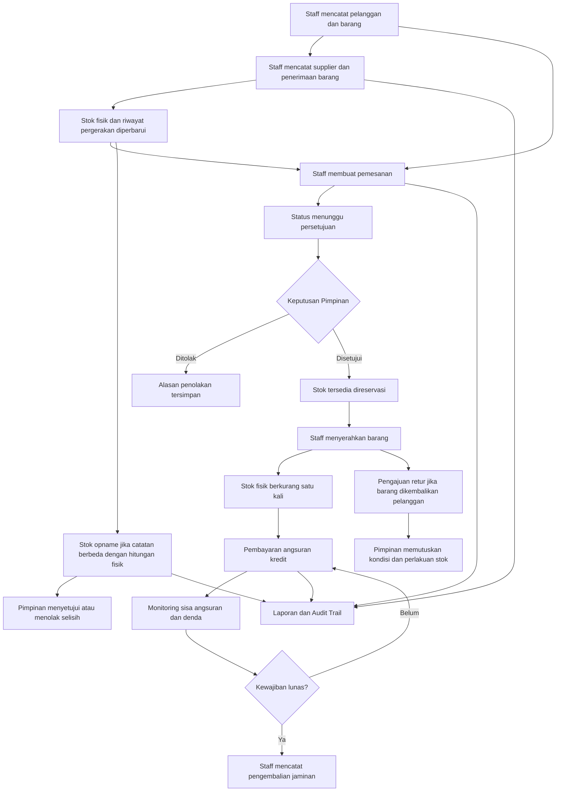

# Panduan Pengguna dan Alur Sistem BUMKam Tuah Rezeki

Panduan ini menjelaskan cara kerja modul BUMKam Tuah Rezeki dan hubungan datanya. Aplikasi dipakai oleh **Staff** untuk pekerjaan operasional dan **Pimpinan** untuk pemantauan, persetujuan, verifikasi, serta pengelolaan akun Staff.

## Gambaran alur utama

## Peran pengguna

### Staff

Staff menangani pekerjaan harian, antara lain:

- mencatat pelanggan, barang, dan supplier;
- mencatat barang masuk dan memantau stok;
- membuat pemesanan dan melengkapi data jaminan;
- mencatat pembayaran tunai atau membuat transaksi online;
- melihat jadwal angsuran, kredit, dan alasan penolakan jaminan;
- mengajukan retur, mencatat stok opname, serta mencatat pengeluaran operasional.

### Pimpinan

Pimpinan memantau dashboard, laporan, dan Audit Trail; menyetujui atau menolak pemesanan, retur, dan stok opname; memverifikasi jaminan; memutuskan pengurangan denda; mengelola akun Staff; serta melakukan koreksi pembayaran sesuai fitur yang tersedia. Hak akses diperiksa di backend, tidak hanya melalui tombol pada halaman.

## Alur persediaan

### Barang dan barang masuk

1. Katalog **Barang** menyimpan identitas barang, kategori, dan harga jual. Barang baru mulai dengan stok awal nol.
2. Staff mencatat **Supplier**.
3. Saat barang diterima dari supplier, Staff mencatat tanggal, faktur bila ada, barang, jumlah, dan harga satuan pada **Barang Masuk**.
4. Penerimaan menambah stok fisik dan mencatat pergerakan stok. Riwayat ini menghubungkan perubahan jumlah dengan transaksi penerimaan.
5. **Monitoring Stok** menampilkan stok fisik, stok yang dipesan, stok tersedia, stok kritis, dan riwayat pergerakan.

### Stok fisik, dipesan, dan tersedia

- **Stok fisik** adalah jumlah yang tercatat tersedia secara fisik.
- **Stok dipesan** adalah bagian stok yang dialokasikan untuk pemesanan yang sudah disetujui tetapi belum diserahkan.
- **Stok tersedia** dihitung sebagai stok fisik dikurangi stok dipesan.

Pengajuan yang masih menunggu persetujuan tidak langsung mengurangi stok. Ketika barang diserahkan, stok fisik berkurang satu kali dan reservasi dilepas.

### Perbedaan Barang Masuk, Stok Opname, dan Retur

| Modul | Kapan digunakan | Dampak stok |
|---|---|---|
| **Barang Masuk** | Barang baru benar-benar diterima dari supplier | Menambah stok fisik berdasarkan jumlah yang diterima |
| **Stok Opname** | Jumlah hasil hitung fisik berbeda dari catatan sistem | Pimpinan dapat menyetujui penyesuaian selisih; perubahan dicatat sebagai pergerakan stok |
| **Retur Pelanggan** | Pelanggan mengembalikan barang yang telah diserahkan | Setelah keputusan Pimpinan, barang yang layak dapat dimasukkan lagi ke stok; barang rusak atau belum diperiksa tidak otomatis masuk |

Pada stok opname, sistem menyimpan angka stok sistem saat Staff melakukan pencatatan. Jika angka stok berubah sebelum Pimpinan menyetujui, hasil itu tidak diterapkan; lakukan penghitungan ulang agar catatan terbaru tidak tertimpa.

## Alur pemesanan dan jaminan

1. Staff memilih pelanggan dan barang, menentukan jumlah, tanggal, skema pembayaran, DP bila ada, dan tenor.
2. Untuk pengajuan kredit, Staff mengisi jenis jaminan, nomor resmi yang tercetak pada dokumen, tanggal penyerahan, dan keterangan bila diperlukan.
3. Data jaminan terhubung ke pemesanan yang sama. Staff tidak perlu memasukkan ulang data jaminan di menu Manajemen Jaminan.
4. Pengajuan masuk ke status **Menunggu Persetujuan**. Pimpinan memeriksa rincian, lalu menyetujui atau menolak dengan alasan.
5. Jika disetujui, stok tersedia dialokasikan untuk pesanan. Setelah barang diserahkan, pergerakan stok keluar tercatat.
6. Pimpinan memverifikasi dokumen jaminan. Staff dapat memperbaiki informasi sesuai kewenangan dan melihat alasan penolakan. Setelah kewajiban kredit lunas, Staff dapat mencatat pengembalian dokumen.

Dokumen pribadi disimpan pada penyimpanan privat dan dibuka melalui route terautentikasi. Jangan membagikan path penyimpanan atau mengunggah salinan dokumen ke lokasi publik.

## Alur pembayaran, angsuran, dan denda

1. Staff memilih pemesanan kredit yang dapat dibayar, tanggal, metode pembayaran, nominal, dan bukti jika ada.
2. Pembayaran tunai dicatat sebagai diterima setelah disimpan. Pembayaran sebagian mengurangi kewajiban sesuai jumlah yang dialokasikan.
3. Pembayaran online melalui Midtrans berstatus **pending** belum dihitung sebagai pembayaran diterima. Status baru dihitung setelah notifikasi Midtrans yang valid berstatus **settlement**. Redirect browser saja tidak menandakan pembayaran berhasil.
4. Sistem mengalokasikan pembayaran ke sisa pokok angsuran terlebih dahulu, lalu denda pada angsuran yang sama. Kelebihan di luar kewajiban yang dapat dibayar ditolak.
5. Denda keterlambatan menggunakan kebijakan awal aplikasi:

   `Denda = sisa angsuran × 0,1% × hari keterlambatan`

   Hari keterlambatan dihitung setelah masa tenggang tujuh hari, dengan batas maksimal 5% dari sisa angsuran. Angsuran lunas tidak dikenakan denda dan denda tidak berbunga.

6. Pimpinan dapat mengurangi atau membebaskan denda dengan alasan. Nilai awal, pengurangan, alasan, identitas Pimpinan, dan waktu keputusan disimpan.
7. Pimpinan dapat mencatat reversal pembayaran tunai yang diterima. Riwayat transaksi tetap disimpan; pembayaran online disinkronkan dari Midtrans.
8. Setelah seluruh kewajiban pokok dan denda lunas, proses pengembalian jaminan dapat dicatat.

**Catatan retur:** pengajuan retur saat ini mengelola keputusan atas barang dan stok. Retur tidak otomatis membuat refund uang atau mengurangi saldo kredit. Bila retur memerlukan koreksi pembayaran, gunakan alur reversal/refund yang tersedia dan pastikan hasilnya sesuai keputusan operasional.

## Pengeluaran, laporan, dan Audit Trail

- **Pengeluaran Operasional** mencatat uang keluar untuk kebutuhan seperti listrik, transportasi, atau ATK. Pengeluaran tidak menambah stok dan bukan pembayaran angsuran pelanggan.
- **Laporan** menyediakan pilihan Pemesanan, Kredit, Penerimaan Pembayaran, Penerimaan Barang, Piutang Kredit, Pendapatan Denda, Persediaan, dan Pengeluaran. Pilih jenis serta rentang tanggal, lalu gunakan tombol cetak pada laporan yang ditampilkan.
- Pokok angsuran, denda, penerimaan pembayaran, pembelian barang, dan pengeluaran ditampilkan terpisah sesuai jenis laporan.
- **Audit Trail** membantu menelusuri login dan aktivitas penting, termasuk keputusan serta perubahan data. Hindari memasukkan NIK, password, atau isi dokumen ke catatan bebas.

## Pengingat WhatsApp

Pengingat angsuran dijadwalkan tiga hari sebelum jatuh tempo bagi kredit yang memenuhi syarat dan pelanggan yang telah menyetujui pengingat WhatsApp. Pengiriman memakai Kirima. Persetujuan pelanggan harus dicatat sebelum pengiriman; transaksi uji hanya menggunakan nomor dan data dummy.

## Ringkasan alur sehari-hari

1. Pastikan pelanggan, barang, dan supplier sudah terdata.
2. Catat penerimaan barang untuk menambah stok.
3. Buat pemesanan dan tunggu persetujuan Pimpinan.
4. Serahkan barang yang disetujui dan catat pembayaran angsuran.
5. Pantau jadwal, sisa kewajiban, dan denda; tindak lanjuti jaminan setelah lunas.
6. Gunakan retur hanya untuk barang yang dikembalikan pelanggan dan stok opname hanya untuk memperbaiki selisih hitungan.
7. Catat pengeluaran, lalu tinjau laporan dan Audit Trail sesuai periode.
